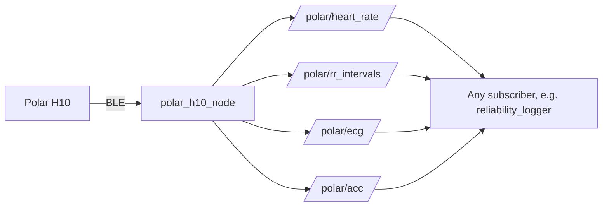

# Polar H10 for ROS 2

ROS 2 Jazzy driver for the **Polar H10** chest strap. It connects over Bluetooth Low Energy and publishes **raw** heart rate, RR intervals, ECG and accelerometer data as ROS topics, so that other ROS components (for example emotion or intent recognition, or a robot arm controller) can use them.

Developed as part of a Forschungsmodul at the Healthcare Lab, University of Augsburg.

## Features

- All four Polar H10 data streams in ROS: heart rate (1 Hz), RR intervals, ECG (130 Hz) and accelerometer (up to 200 Hz)
- Raw data only, no filtering in the node; preprocessing is done downstream
- Custom messages with units in the field names and two timestamps (host reception time and sensor clock)
- Automatic reconnection after Bluetooth interruptions
- Reliability logger node and analysis scripts (data rate, lost frames, latency, BLE jitter, clock drift)
- Standalone recording and analysis scripts without ROS (including R peak detection with NeuroKit2)

## Architecture



The BLE communication (bleak, asyncio) runs in a separate thread with its own event loop; ROS spins in the main thread. BLE callbacks publish directly to ROS topics.

## Topics and messages

| Topic | Message | Rate | Content |
| --- | --- | --- | --- |
| `/polar/heart_rate` | `polar_msgs/HeartRate` | 1 Hz | `bpm` as reported by the Polar Heart Rate Service |
| `/polar/rr_intervals` | `polar_msgs/RRIntervals` | 1 Hz | `rr_ms[]`, 0 to 3 intervals per packet (empty = no beat detected) |
| `/polar/ecg` | `polar_msgs/ECG` | 1.78 Hz | one frame of 73 samples, `samples_uv[]` at 130 Hz |
| `/polar/acc` | `polar_msgs/Accelerometer` | 5.56 Hz | one frame of 36 samples, `x_mg[]`, `y_mg[]`, `z_mg[]` at 200 Hz |

Every message has a `std_msgs/Header`: `header.stamp` is the ROS time when the packet was received on the host. ECG and accelerometer messages additionally carry `sensor_timestamp_ns` (Polar sensor clock, timestamp of the last sample in the frame) and `sample_rate_hz`. For time-critical analysis, use the sensor timestamps (corrected for clock drift) rather than the arrival times.

```bash
ros2 interface show polar_msgs/msg/ECG
```

## Repository structure

```
polar-h10-ros2/
├── ros2/
│   ├── polar_msgs/                         message definitions
│   └── polar_h10/
│       ├── polar_h10/polar_h10_node.py     Polar node (BLE -> 4 topics)
│       ├── polar_h10/reliability_logger.py test subscriber + CSV log
│       └── launch/polar_h10.launch.py      starts the node (+ logger)
├── scripts/
│   ├── polar_combined.py                   HR/RR + ECG + ACC recording without ROS
│   ├── analyze_recording.py                NeuroKit2 peak detection, HR/RR comparison
│   ├── analyze_reliability.py              reliability log analysis
│   └── polar_hr.py, polar_ecg.py, plot_ecg.py   first test scripts
├── requirements-recording.txt
└── requirements-analysis.txt
```

## Requirements

- Ubuntu 24.04 with ROS 2 Jazzy
- A Bluetooth Low Energy adapter
- Polar H10

Two Python virtual environments are used, because ROS 2 Jazzy works with NumPy 1.26 while NeuroKit2 and pandas need NumPy 2:

| Environment | Used for | Notes |
| --- | --- | --- |
| `polar_venv` | Polar node, launch, recording without ROS | created with `--system-site-packages` so it sees ROS; keeps NumPy 1.26 |
| `analysis_venv` | NeuroKit2, pandas, plots | isolated |

## Installation

```bash
# clone into a ROS 2 workspace
mkdir -p ~/ros2_ws/src
cd ~/ros2_ws/src
git clone https://github.com/<username>/polar-h10-ros2.git

# recording environment (bleak)
python3 -m venv ~/polar_venv --system-site-packages
source ~/polar_venv/bin/activate
pip install -r ~/ros2_ws/src/polar-h10-ros2/requirements-recording.txt
deactivate

# analysis environment (NeuroKit2)
python3 -m venv ~/analysis_venv
source ~/analysis_venv/bin/activate
pip install -r ~/ros2_ws/src/polar-h10-ros2/requirements-analysis.txt
deactivate

# build (no venv active)
cd ~/ros2_ws
colcon build --packages-select polar_msgs polar_h10
```

Do not use `--symlink-install` for `polar_h10`: `setup.cfg` sets `executable = /usr/bin/env python3`, which only applies to a normal build and lets the node use the active `polar_venv` (where bleak is installed).

After code changes, rebuild with `colcon build --packages-select polar_h10` (or `polar_msgs`) and source the workspace again.

## Before you start

- Wet the strap electrodes and wear the strap; the sensor only wakes up with skin contact.
- Turn off Bluetooth on your phone or close the Polar app; the H10 accepts only one connection at a time.
- Close any open `bluetoothctl` session.
- Set your sensor's MAC address with the `mac_address` launch argument. To find it:

```bash
bluetoothctl
power on
scan on      # look for "Polar H10 XXXXXXXX"
scan off
exit
```

## Usage

### Start the node

```bash
source ~/polar_venv/bin/activate
source ~/ros2_ws/install/setup.bash
ros2 launch polar_h10 polar_h10.launch.py mac_address:=XX:XX:XX:XX:XX:XX
```

Launch arguments:

| Argument | Default | Description |
| --- | --- | --- |
| `mac_address` | `A0:9E:1A:C4:7F:89` | MAC address of the Polar H10 |
| `acc_sample_rate` | `200` | accelerometer sample rate: 25, 50, 100 or 200 Hz |
| `acc_range` | `8` | accelerometer range: 2, 4 or 8 G |
| `log` | `false` | also start the reliability logger |

Expected log messages: `Scanning...`, `Connected to Polar H10 ...`, `Start ECG: OK`, `Start ACC: OK`, `Streaming HR, RR, ECG and ACC`. Connecting can take between 1 and 22 s. ECG and accelerometer data start 1 to 7 s after the start command.

### Inspect the data (live demo)

In another terminal:

```bash
source ~/ros2_ws/install/setup.bash
ros2 topic list | grep polar
ros2 topic echo /polar/heart_rate
ros2 topic echo --once /polar/ecg
ros2 topic hz /polar/ecg                          # ~1.78 Hz
ros2 run rqt_plot rqt_plot /polar/heart_rate/bpm  # live heart rate plot
rqt_graph                                         # node and topic graph
```

Stop with Ctrl+C; the node stops the sensor streams and disconnects. The `Failed to publish log message to rosout` warning on shutdown is harmless.

### Reliability tests

```bash
source ~/polar_venv/bin/activate
source ~/ros2_ws/install/setup.bash
ros2 launch polar_h10 polar_h10.launch.py log:=true
```

The logger writes one row per received message to `~/polar_tests/reliability/log_<date_time>.csv` (change with the `output_dir` parameter). Optionally record the raw data as a rosbag:

```bash
ros2 bag record /polar/heart_rate /polar/rr_intervals /polar/ecg /polar/acc -o <test_name>
```

Analyze the log:

```bash
source ~/analysis_venv/bin/activate
python scripts/analyze_reliability.py                       # latest log
python scripts/analyze_reliability.py <path/to/log.csv>     # a specific log
```

Output: message and sample rates, lost frames (from sensor timestamps), ROS transport latency, BLE delay variation and clock drift, plus a figure saved next to the log.

| Test | Procedure |
| --- | --- |
| T1 Continuous | 60 min seated next to the laptop |
| T2 Strap removed | remove the strap for 30 s during recording, put it back (3 times) |
| T3 Out of range | walk away until the connection drops, come back (3 times) |
| T4 Distance | 5 min each at 1, 3, 5 and 10 m |

### Recording without ROS

```bash
source ~/polar_venv/bin/activate
python scripts/polar_combined.py 120     # duration in seconds
```

Records HR/RR, ECG and accelerometer simultaneously to `recordings/<date_time>/` (`hr.csv`, `ecg.csv`, `acc.csv`) and prints the settings supported by the sensor and a summary.

```bash
source ~/analysis_venv/bin/activate
python scripts/analyze_recording.py recordings/<date_time>
```

Detects R peaks with NeuroKit2, checks HR and RR against typical ranges (HR 40 to 180 bpm, RR 300 to 2000 ms), compares ECG-derived HR and RR with the Polar values and saves `peaks.png`, `hr_comparison.png` and `rr_comparison.png`.

## Validation results (example recordings)

- **Data rates** match the sensor: HR 1.000 msg/s, ECG 130.0 samples/s, accelerometer 200.0 samples/s.
- **No lost frames** in a 6 min continuous run (673 ECG and 2100 accelerometer frames).
- **ROS transport latency** about 1 ms (max 2.6 ms).
- **BLE delay variation** median 23 to 36 ms, 95th percentile 70 to 89 ms; arrival intervals form discrete levels about 35 to 40 ms apart (BLE connection interval).
- **Clock drift** of the sensor clock about -21 to -27 ppm relative to the host.
- **RR intervals** from Polar and from the raw ECG (NeuroKit2) agree beat by beat: 150 matched beats, mean absolute difference 2.5 ms, r = 1.00. The Polar HR value is smoothed by an undocumented algorithm; for analysis, RR intervals or ECG are preferred.

## Troubleshooting

| Error / symptom | Fix |
| --- | --- |
| `Polar H10 not found` | wet and wear the strap, turn off the phone's Bluetooth |
| `connection failed: TimeoutError` | the node retries; otherwise `sudo systemctl restart bluetooth` |
| Never connects while `bluetoothctl` is connected | `disconnect` and `exit` in `bluetoothctl` (one connection only) |
| `ModuleNotFoundError: bleak` | activate `polar_venv` |
| `No executable found` / `Package 'polar_h10' not found` | build, then `source ~/ros2_ws/install/setup.bash` |
| NumPy 1.x / 2.x error | run analysis scripts in `analysis_venv`, never install NeuroKit2 or pandas into `polar_venv` |
| Large jumps in ECG, implausible RR values | poor electrode contact or movement: wet the electrodes, tighten the strap, sit still |

## Protocol references

- Heart rate and RR intervals: Bluetooth SIG Heart Rate Service (0x180D), Heart Rate Measurement characteristic (0x2A37)
- ECG and accelerometer: Polar Measurement Data (PMD) service `fb005c80-02e7-f387-1cad-8acd2d8df0c8`, see the [Polar BLE SDK](https://github.com/polarofficial/polar-ble-sdk)

## License

Apache-2.0
